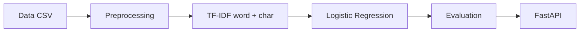

# 🇹🇷 Turkish Sentiment Analysis (NLP)

[](https://github.com/bilgeozcan/turkish-sentiment-classifier/actions/workflows/ci.yml)
[](LICENSE)
[](https://www.python.org/)

A Turkish text sentiment classifier built with scikit-learn. It combines Turkish-aware preprocessing with word and character TF-IDF features and Logistic Regression for baseline sentiment classification.

## Features
- Turkish-correct lowercasing (`I -> ı`, `İ -> i`)
- URL, mention, punctuation, digit, and repetition cleaning
- `FeatureUnion` of word (1-2) and char (2-5) TF-IDF features
- CLI for training and prediction, model persistence with `joblib`
- Stratified k-fold evaluation, confusion matrix, and misclassification reports
- FastAPI HTTP service
- Docker and GitHub Actions support
- Optional Turkish BERT fine-tuning notebook



> ⚠️ `data/sample.csv` is a tiny toy dataset (48 sentences) for demos and tests only.
> It is excluded from Git. Use a real labeled dataset for meaningful results.

## Installation
```bash
python -m venv .venv
# Windows: .venv\Scripts\activate
# Linux/macOS: source .venv/bin/activate
python -m pip install -r requirements.txt
```

Optional notebook dependencies:

```bash
python -m pip install -r requirements-notebook.txt
```

## CLI usage
```bash
# Train
python -m src.sentiment.cli train --data data/sample.csv --out models/sentiment.joblib

# Predict
python -m src.sentiment.cli predict --model models/sentiment.joblib "ürün harika"

# Stratified k-fold evaluation
python -m src.sentiment.cli evaluate --data data/sample.csv --folds 5 --output reports/confusion_matrix.png

# Misclassified examples
python -m src.sentiment.cli errors --data data/sample.csv --model models/sentiment.joblib --output reports/misclassified.csv
```

## API usage
```bash
python -m uvicorn src.sentiment.app:app --host 0.0.0.0 --port 8000
curl -X POST "http://localhost:8000/predict" -H "Content-Type: application/json" -d "{\"text\":\"ürün harika\"}"
curl "http://localhost:8000/health"
```

## Docker usage
```bash
docker build -t turkish-sentiment-classifier:local .
docker run --rm -p 8000:8000 turkish-sentiment-classifier:local
```

## Make targets
```bash
make install
make lint
make test
make train
make serve
make docker
```

## Results
| Dataset | Model | Accuracy | Macro-F1 |
|---------|-------|----------|----------|
| `<DATASET_PLACEHOLDER>` | TF-IDF word+char + Logistic Regression | `<ACCURACY_PLACEHOLDER>` | `<MACRO_F1_PLACEHOLDER>` |
| `<DATASET_PLACEHOLDER>` | dbmdz/bert-base-turkish-cased | `<ACCURACY_PLACEHOLDER>` | `<MACRO_F1_PLACEHOLDER>` |

## Testing
```bash
python -m ruff check .
python -m pytest -q
```

## Author
Nur Bilge Özcan · [GitHub](https://github.com/BILGEOZCAN) · [LinkedIn](https://linkedin.com/in/nur-bilge-özcan-123975257)

Licensed under the MIT License.
